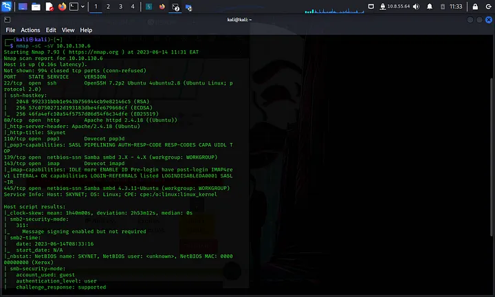
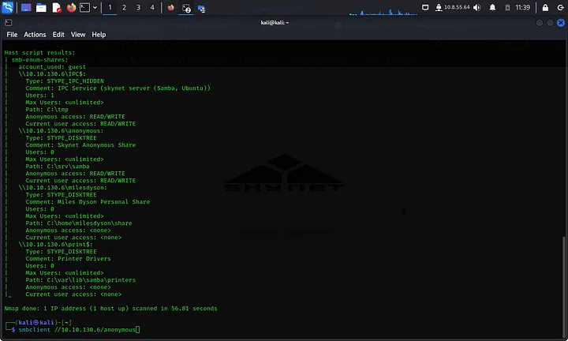
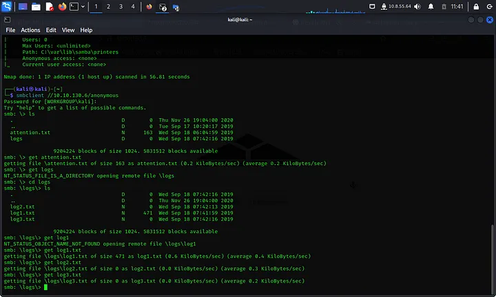
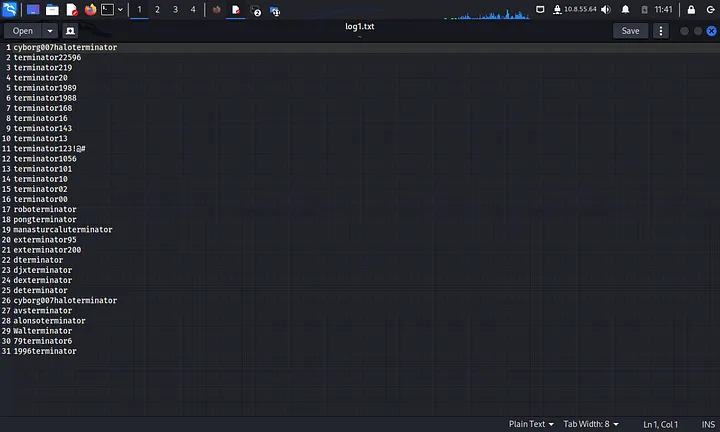
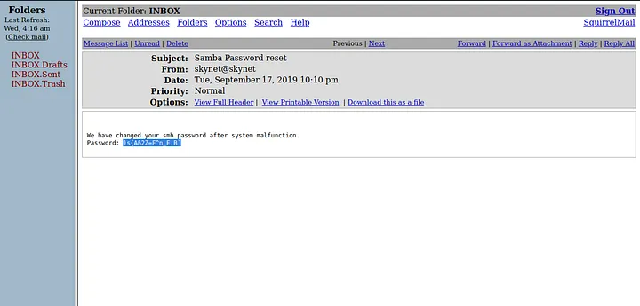
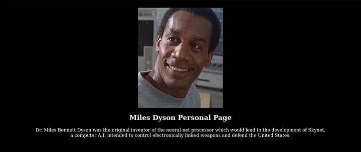
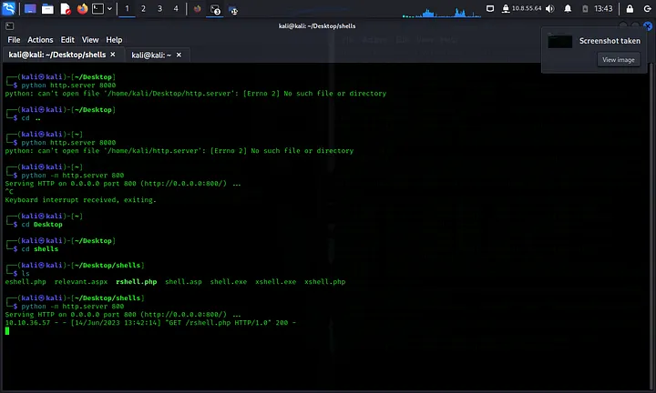
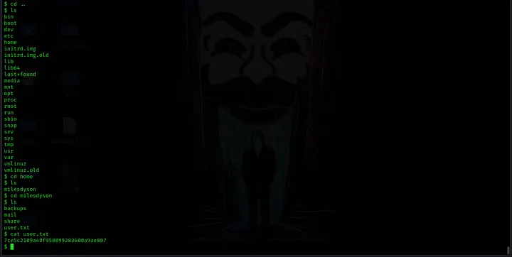
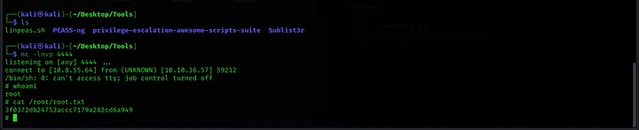

# TryHackMe: Skynet --- Penetration Testing Report

> **Author:** Mwaraem\
> **Platform:** TryHackMe\
> **Target:** Skynet\
> **Assessment type:** CTF / penetration-testing lab\
> **Operating system:** Linux\
> **Original assessment date:** July 2023\
> **Report status:** Historical assessment; documentation reconstructed
> from the original Medium write-up and its screenshots.

## 1. Executive summary

This report documents a penetration-testing exercise against the Skynet
machine hosted on TryHackMe. The assessment involved identifying exposed
network services, enumerating SMB shares, investigating web
applications, discovering credentials, obtaining initial access through
a reported Cuppa CMS vulnerability, and escalating privileges on the
Linux host.

The original assessment records the following high-level stages:

-   Network reconnaissance and service identification using Nmap.
-   Anonymous SMB access and discovery of files, including a wordlist.
-   Web directory enumeration and discovery of a SquirrelMail login
    interface.
-   Authentication testing against the mail interface using Hydra.
-   Discovery of credentials in an inbox message and subsequent
    authenticated SMB access.
-   Discovery of an additional web path and a Cuppa CMS administration
    interface.
-   Exploitation of a reported Remote File Inclusion (RFI) vulnerability
    to obtain a shell.
-   Linux post-exploitation enumeration using LinPEAS.
-   Identification of a backup-related privilege-escalation opportunity
    and retrieval of the root flag.

The exercise illustrates how information exposed through one service can
assist an attacker in accessing other services, and how weaknesses in a
web application and host configuration can be chained in a controlled
lab.

## 2. Scope and methodology

### 2.1 Scope

The target was the Skynet machine provided within the TryHackMe training
environment. The activity documented here relates to that authorized lab
target only.

### 2.2 Methodology

The workflow described in the original write-up can be grouped into
these phases:

1.  **Reconnaissance:** Identify exposed ports and running services.
2.  **Enumeration:** Investigate SMB shares, files, web directories and
    application entry points.
3.  **Credential discovery:** Use information recovered during
    enumeration to test authentication.
4.  **Initial access:** Investigate and exploit the reported web
    application vulnerability.
5.  **Post-exploitation:** Enumerate the compromised Linux host.
6.  **Privilege escalation:** Investigate the backup mechanism and
    obtain elevated access.

### 2.3 Tools identified in the original write-up

  Tool           Use documented in the assessment
  -------------- ------------------------------------------------
  Nmap           Network scanning and service/version detection
  SMBClient      Accessing and enumerating SMB shares
  Gobuster       Web directory enumeration
  Hydra          Authentication testing
  Searchsploit   Researching known Cuppa CMS vulnerabilities
  Netcat         Receiving the reverse shell
  LinPEAS        Linux post-exploitation enumeration

The report does not add tool versions or exact command lines where they
were not preserved in the source material.

## 3. Reconnaissance and service enumeration

### 3.1 Nmap scan

The assessment began with an Nmap scan using the `-sC` and `-sV` options
to run default scripts and identify service versions.

The original write-up records these open ports and services:

  Port      Service   Information recorded
  --------- --------- ----------------------
  22/tcp    SSH       SSH service
  80/tcp    HTTP      Web application
  110/tcp   POP3      Mail service
  139/tcp   SMB       Samba
  143/tcp   IMAP      Mail service
  445/tcp   SMB       Samba `smbd 4.3.11`

The presence of SMB, HTTP and mail services provided several potential
avenues for further enumeration.



*Figure 1 --- Nmap scan showing the services identified during
reconnaissance.*

### 3.2 SMB enumeration

SMB was investigated as an initial enumeration opportunity. The original
assessment identified multiple shares, including a share associated with
the user `milesdyson`.

The anonymous share was accessed without supplying authenticated
credentials. The write-up records that two files were initially found.
`attention.txt` was downloaded and reviewed, but did not provide
particularly useful information.

Further enumeration identified a `logs` directory containing three log
files:

-   `log1.txt`
-   `log2.txt`
-   `log3.txt`

The second and third files were empty. The first contained a collection
of strings that appeared to form a wordlist. This information was
retained for later authentication testing.



*Figure 2 --- SMB enumeration results.*



*Figure 3 --- Access to the anonymous SMB share.*

**Security observation:** Anonymous SMB access exposed files and
information that could be useful during subsequent attacks. Share
permissions should be configured so that unauthenticated users cannot
access internal or sensitive resources unless explicitly required.

## 4. Web application enumeration and credential discovery

### 4.1 Directory discovery

The HTTP service on port 80 was enumerated using Gobuster. The original
write-up identifies a `squirrelmail` directory containing a login
interface.

The wordlist recovered from the SMB share was then considered for
authentication testing against this interface.



*Figure 4 --- Web directory enumeration.*

### 4.2 SquirrelMail authentication testing

Hydra was used to test the SquirrelMail login interface with the
wordlist obtained from the anonymous SMB share. The original write-up
reports that this testing produced a successful login.

After accessing the mailbox, an inbox message disclosed a password. That
password was subsequently tested against the SMB share associated with
`milesdyson`, and the assessment reports successful authentication.

This sequence demonstrated how information exposed through one service
could be used to gain access to another service.


*Figure 5 --- Original terminal evidence associated with authentication
testing and web enumeration.*



*Figure 6 --- Mail application evidence from the original assessment.*

**Security observation:** Weak authentication controls and credential
reuse can turn an information-disclosure issue into access across
multiple services. Unique credentials, rate limiting and monitoring of
repeated authentication failures help reduce this risk.

## 5. Authenticated SMB enumeration

After obtaining credentials from the mailbox, the `milesdyson` SMB share
was accessed.

Further enumeration identified a `notes` directory containing a file
named `important.txt`. The original write-up records that the file was
downloaded and examined.

Its contents revealed an additional web application path:

``` text
/45kra24zxs28v3yd
```

The path was visited in the browser and investigated with another
Gobuster scan. This scan identified an `/administrator` directory.

Navigating to `/administrator` revealed an administration login page
associated with Cuppa CMS.


*Figure 7 --- Original evidence from the authenticated SMB enumeration
stage.*


*Figure 8 --- Evidence associated with discovery of the additional
application path.*



*Figure 9 --- The additional web page identified during enumeration.*


*Figure 10 --- Further directory enumeration of the discovered path.*


*Figure 11 --- Cuppa CMS administration login interface.*

**Security observation:** Information stored in an accessible share can
disclose internal paths and expand the application attack surface. Files
exposed through network shares should be reviewed for sensitive
operational information.

## 6. Initial access --- Cuppa CMS

### 6.1 Vulnerability research

After identifying the Cuppa CMS administration interface, Searchsploit
was used to research known vulnerabilities affecting the CMS.

The original write-up reports that the research identified a Remote File
Inclusion (RFI) vulnerability. It describes preparing a reverse-shell
resource and hosting it from the attacking machine.

RFI vulnerabilities can allow an application to include content from an
attacker-controlled remote resource when the application is vulnerable
and its configuration permits the relevant behavior.

### 6.2 Reverse-shell access

According to the original account, a web server was configured to make
the reverse-shell resource available. The resource was then triggered
while a Netcat listener was running on the attacking machine.

The write-up reports that this resulted in a shell on the target,
establishing initial access to the Linux host.



*Figure 12 --- Original screenshot associated with the initial-access
stage.*

**Result recorded in the original assessment:** A shell on the target
was obtained following exploitation of the reported Cuppa CMS
vulnerability.

> **Reproduction limitation:** The original article does not preserve
> the exact vulnerable parameter, affected CMS component, Searchsploit
> exploit identifier, payload, or complete execution sequence. It also
> uses the terms "upload" and "Remote File Inclusion" in describing the
> process. Those details should be verified against the original lab
> notes before presenting this section as a step-by-step, independently
> reproducible exploit walkthrough.

## 7. Post-exploitation enumeration

After obtaining a shell, the target was enumerated to locate the
user-level flag and identify possible privilege-escalation paths.

The original write-up records the user flag at:

``` text
/home/milesdyson/user.txt
```

The next objective was to obtain root-level access.

### 7.1 LinPEAS

LinPEAS was transferred to the target using a temporary web server. The
original account states that it was placed in `/tmp`, made executable
and run.

The results were reviewed for potentially exploitable permissions,
scheduled tasks and other host-configuration weaknesses.

The investigation highlighted a backup script located at:

``` text
/home/milesdyson/backups/backup.sh
```

The associated backup activity became the focus of the
privilege-escalation investigation.


*Figure 13 --- Original post-exploitation terminal evidence.*



*Figure 14 --- LinPEAS output from the original assessment.*

## 8. Privilege escalation

### 8.1 Backup mechanism investigation

The original write-up reports that scheduled backup activity involved
`/home/milesdyson/backups/backup.sh` and that the backup mechanism ran
with elevated privileges.

It states that the script or its associated configuration provided an
opportunity to execute a command with root-level privileges.

The write-up then describes setting up another Netcat listener and
triggering the backup mechanism, which resulted in an elevated shell.


*Figure 15 --- Original evidence associated with investigation of the
backup mechanism.*


*Figure 16 --- Original terminal evidence from the privilege-escalation
stage.*

### 8.2 Root access verification

The original assessment reports successful root-level access and
identifies the root flag at:

``` text
/root/root.txt
```



*Figure 17 --- Original evidence associated with completion of the
root-level objective.*

**Result recorded in the original assessment:** Root-level access was
obtained and the root flag was located.

> **Reproduction limitation:** The original article does not show enough
> detail to establish the precise privilege-escalation mechanism. It
> says that `backup.sh` could be edited to execute a root shell, but
> later describes executing `backup.tgz` to obtain the elevated shell.
> The exact scheduled command, file permissions, archive contents and
> commands used are not fully documented in the source. These should be
> checked against the original lab notes or by reproducing the exercise
> before naming a specific vulnerability technique.

## 9. Findings and remediation

The following table summarizes the security weaknesses and attack
opportunities described in the original assessment. Severity ratings are
intentionally omitted because the source does not contain enough
evidence for a defensible risk-scoring exercise.

  -----------------------------------------------------------------------
  Finding                 Observed security       Recommended remediation
                          implication             
  ----------------------- ----------------------- -----------------------
  Anonymous SMB access    Unauthenticated access  Disable anonymous
                          exposed files and       access where
                          information.            unnecessary and
                                                  restrict share
                                                  permissions.

  Exposed wordlist        Disclosed material      Remove sensitive files
                          could be used in        from public shares and
                          authentication attacks. audit share contents.

  Weak authentication     Authentication testing  Enforce strong
  controls                against the mail        passwords, rate
                          interface succeeded.    limiting and monitoring
                                                  of failed logins.

  Credential reuse        A password obtained     Require unique
                          through the mail        credentials for each
                          service also enabled    service and rotate
                          SMB access.             exposed credentials.

  Vulnerable web          The reported CMS        Patch or replace
  application component   vulnerability was used  vulnerable components
                          to obtain initial       and restrict unsafe
                          access.                 file inclusion
                                                  behavior.

  Insecure backup-related The backup mechanism    Protect privileged
  configuration           was used in the         scripts and backup
                          reported                files, review
                          privilege-escalation    scheduled-task
                          chain.                  permissions, and avoid
                                                  unsafe archive
                                                  handling.
  -----------------------------------------------------------------------

## 10. Conclusion

The Skynet assessment demonstrated how weaknesses across network
services, authentication mechanisms, web applications and host
configuration can be combined to compromise a Linux system.

SMB enumeration exposed files that supported further investigation. A
recovered wordlist was used during authentication testing against
SquirrelMail, and information obtained from the mailbox enabled access
to another SMB share.

Further enumeration of that share revealed an additional web application
path and a Cuppa CMS administration interface. The original assessment
reports that a known RFI vulnerability was used to obtain initial
access.

Post-exploitation enumeration with LinPEAS then highlighted a
backup-related privilege-escalation opportunity. The exercise concluded
with reported root-level access.

Key practical areas covered included:

-   Network reconnaissance and service enumeration.
-   SMB share discovery and anonymous access investigation.
-   Web directory enumeration.
-   Authentication testing and credential reuse.
-   Vulnerability research and web application exploitation.
-   Linux post-exploitation enumeration.
-   Investigation of privileged backup processes and privilege
    escalation.

The exercise reinforced the importance of methodical enumeration and of
examining how weaknesses across different services can combine to
increase the impact of a compromise.

## 11. Tools and techniques summary

  Phase                    Tools / techniques
  ------------------------ ----------------------------------------------------
  Reconnaissance           Nmap
  SMB enumeration          SMBClient
  Web enumeration          Gobuster
  Authentication testing   Hydra
  Vulnerability research   Searchsploit
  Initial access           Reported Cuppa CMS RFI exploitation; reverse shell
  Shell handling           Netcat
  Linux enumeration        LinPEAS
  Privilege escalation     Backup-related scheduled-task investigation

## 12. Disclaimer

This report documents an authorized cybersecurity training exercise
against the Skynet machine on TryHackMe. The techniques are presented
for educational purposes and authorized security testing only.

Credentials, password hashes and challenge flags have not been
intentionally reproduced in this report. Screenshots are retained as
historical evidence from the original write-up; review them before
public release to ensure no sensitive values remain visible.

------------------------------------------------------------------------

**Original publication:** [TryHackMe: Skynet Writeup ---
Medium](https://medium.com/@mwaraem/tryhackme-skynet-writeup-323cd604d4a1)

**Author:** Mwaraem
